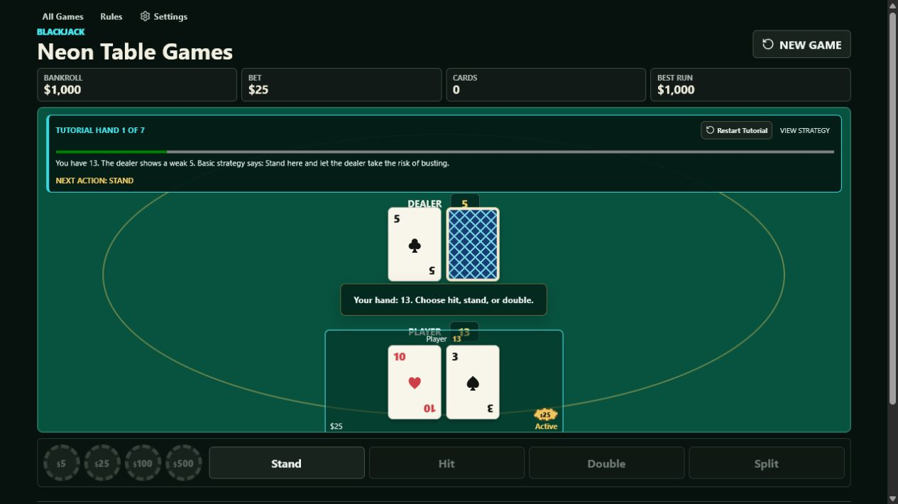
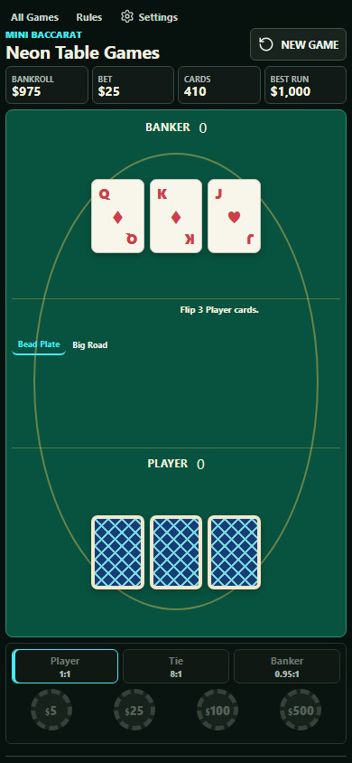

# Neon Table Games

Responsive, play-money table games built as a production web application.

[Play the live site](https://www.neontablegames.com/) | [Blackjack](https://www.neontablegames.com/blackjack/) | [Mini Baccarat](https://www.neontablegames.com/baccarat/) | [Three Card Poker](https://www.neontablegames.com/three-card-poker/)

[](https://github.com/JHoff1/NeonTableGames/actions/workflows/playwright.yml)
[](https://github.com/JHoff1/NeonTableGames/actions/workflows/lighthouse.yml)
[](https://github.com/JHoff1/NeonTableGames/actions/workflows/production-smoke.yml)



<p align="center">
  
</p>

## Project Overview

Neon Table Games is an end-to-end portfolio project focused on stateful frontend
architecture, deterministic game logic, responsive interaction design, and production
quality assurance. It includes three complete games with shared controls and settings,
guided tutorials, persistent sessions, and layouts designed for phones through large
desktop displays.

The site uses virtual chips only. It has no deposits, prizes, cash-out, or real-money
wagering.

## Games

- **Blackjack:** 3 to 2 blackjack, hit, stand, double down, pair splitting, automatic deck
  refresh, strategy reference, round recovery, and a seven-hand tutorial.
- **Mini Baccarat:** Standard third-card rules, Banker commission, Player/Banker/Tie bets,
  sequential reveals, Bead Plate and Big Road history, shoe status, and guided play.
- **Three Card Poker:** Ante and Play wagers, optional Pair Plus, dealer qualification,
  Ante Bonus and Pair Plus paytables, manual card reveals, and a deterministic tutorial.

## Engineering Highlights

- Shared React and TypeScript application shell with reusable cards, wagering controls,
  dialogs, settings, session panels, and tutorial progress.
- Game engines kept separate from rendering so scoring, drawing rules, and payouts can be
  tested without a browser.
- Versioned local persistence with unfinished-round recovery and cross-tab conflict
  handling.
- Seeded debug mode for reproducing exact card sequences with `?seed=failed-test-42`.
- Privacy-conscious first-party error reporting through a client-throttled, origin-validated Netlify Function.
- Responsive and accessible interaction coverage across Chromium, Firefox, and WebKit.
- Automated Lighthouse budgets and revision-aware smoke tests against the deployed site.

## Architecture

```text
Game route
  -> React game application
    -> Shared shell, controls, settings, and session UI
    -> Game-specific controller
      -> Deterministic game engine
      -> Versioned local storage

Netlify
  -> Vite production build
  -> Static game and rules routes
  -> Scrubbed client-error function
```

Key directories:

```text
src/                 React applications and shared UI
shared/              Framework-independent game and session engines
tests/unit/           Engine, persistence, and simulation tests
tests/*.spec.cjs      Responsive, accessibility, and navigation tests
netlify/functions/    First-party production error endpoint
docs/                 Device QA checklist and project images
```

## Run Locally

Requirements: Node.js 24.

```powershell
npm ci
npm run dev
```

Vite prints the local URL after startup. To validate the production output:

```powershell
npm run build
npm run preview
```

## Quality Assurance

Install the browser engines once, then run the complete local suite:

```powershell
npx playwright install chromium firefox webkit
npm test
```

The suite covers linting, formatting, payout engines, seeded statistical simulations,
storage migrations, cross-tab synchronization, unfinished-round recovery, tutorials,
keyboard interaction, accessibility, navigation, and responsive layouts.

Additional production checks:

```powershell
npm run test:performance
npm run test:production
```

GitHub Actions runs the full browser suite and Lighthouse budgets on changes to `master`.
After those checks pass, production smoke tests wait for Netlify to serve the exact Git
revision before validating the live routes and assets. A scheduled smoke test also runs
daily.

Physical-device checks for Safari iOS, Samsung Internet, and Chrome Android are documented
in [docs/visual-regression-checklist.md](docs/visual-regression-checklist.md).

## Deployment

Netlify runs `npm run build` and publishes `dist`. Other static hosts can use the same build
command and output directory; the error-reporting function is the only Netlify-specific
runtime component.

## License

Licensed under the [Apache License 2.0](LICENSE). The favicon uses the Bootstrap Icons
`suit-spade-fill` path under the MIT License.
